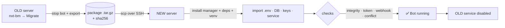

[README.md](https://github.com/user-attachments/files/33942740/README.md)
<div align="center">

# ⚡ NXT-BM

### NexusNet Bot Manager

**Install · Update · Backup · Migrate · Secure** your NexusNet Telegram bot — from one command.


[English](README.md) · [فارسی](README.fa.md)

</div>

---

## ✨ Why NXT-BM

| | |
|---|---|
| 🚀 **One-command VPS migration** | Move the whole bot (code, DB, keys, service) to a new server over SSH. No manual copying. |
| 🔄 **Safe updates** | Update from a local ZIP. `.env`, database and license keys are never touched. Automatic backup + one-key rollback. |
| 🔐 **Keys & License center** | Change token, admins, encryption key, license key — or generate a brand-new license key pair — from a menu. |
| 💾 **Consistent backups** | SQLite hot-backup while the bot is running. Full or DB-only, auto-pruned. |
| 🩺 **Diagnostics** | Validates `.env`, Fernet key, DB integrity, Telegram token, webhook state and token conflicts. |
| 🛡️ **Safe by default** | Confirmations on destructive actions, `chmod 600` on secrets, syntax-checked self-update. |

---

## 📦 Install

```bash
bash <(curl -fsSL https://raw.githubusercontent.com/SiNaKeEn/NexusNet-Bot/Manager/install.sh)
```

Then run:

```bash
nxt-bm
```

> No need to type `sudo` — the manager elevates itself.
> Upgrading from the old `nexusnetmanager` command? It still works (it becomes a link to `nxt-bm`).

---

## 🖥️ Menu

```
╔══════════════════════════════════════════════════╗
║          N E X U S N E T  -  Bot Manager         ║
╠══════════════════════════════════════════════════╣
║  [1]  » Install Manager     [2]  » Update Manager║
║  [3]  » Uninstall Manager                        ║
╠══════════════════════════════════════════════════╣
║  [4]  » Install Bot         [5]  » Update Bot    ║
║  [6]  » Backup              [7]  » Restore       ║
║  [8]  » Migrate VPS         [9]  » Service       ║
║  [10] » Diagnostics         [11] » Uninstall Bot ║
║  [12] » Keys & License      [13] » Rollback      ║
╚══════════════════════════════════════════════════╝
```

---

## 🚚 Migrate to a new VPS



### Automatic (recommended)

On the **old** server:

```bash
nxt-bm          # → [8] Migrate VPS → [2] Push to new server
```

Enter the new server's IP, SSH port and user. NXT-BM exports, uploads, installs and imports for you.
You only need SSH access to the new VPS (a fresh Ubuntu/Debian is enough).

### Manual

```bash
# OLD server
nxt-bm migrate-export
scp /root/nexusnet-migrate/nexusnet-migrate-* root@NEW_IP:/root/

# NEW server
bash <(curl -fsSL https://raw.githubusercontent.com/SiNaKeEn/NexusNet-Bot/Manager/install.sh)
nxt-bm migrate-import /root/nexusnet-migrate-XXXX.tar.gz
nxt-bm doctor
```

### What is in the package

| Item | Notes |
|------|-------|
| `.env` | token, encryption key, license keys |
| Database | consistent SQLite hot copy |
| `data/`, `license_*.pem` | |
| Code snapshot | the new server needs **no ZIP** |
| systemd unit, cron lines | paths fixed automatically if the install dir differs |

The virtualenv is rebuilt on the new server. The package checksum is verified, the DB integrity is checked, and the Telegram token / webhook / conflicts are tested after start.

> ⚠️ **Never run the bot on two servers with the same `BOT_TOKEN`.** NXT-BM disables the old service at cut-over.
> Webhook mode: point your DNS to the new IP and set up reverse proxy + TLS there.
> The package contains secrets — delete it after use.

---

## 🔐 Keys & License

`nxt-bm keys` (or menu **12**)

| Setting | What NXT-BM does |
|---------|------------------|
| `BOT_TOKEN` | Format check + live check with Telegram `getMe` |
| `ADMIN_IDS`, `BOT_OWNER_ID` | Validated numeric IDs |
| `CREDENTIAL_ENCRYPTION_KEY` | Paste an existing key (validated) or generate a new Fernet key. New key = saved panel passwords become unreadable → requires typing `ROTATE`, backup first |
| `LICENSE_KEY` | Uses `deploy/activate_license.py` if present, else writes directly |
| License key pair | Runs `deploy/generate_license_keys.py`, writes `LICENSE_SIGNING_PRIVATE_KEY` into `.env` in the correct one-line format, prints the `LICENSE_VERIFY_PUBLIC_KEY` line for customers. Old pair is backed up; requires typing `NEW-KEYS` |
| Any variable | `REDIS_URL`, `WEBHOOK_*` … |

Every change first backs up your `.env` to `/opt/nexusnet/backups/`.
Quick edit from the shell: `nxt-bm env-set KEY VALUE`

```
license_private.pem  →  keep ONLY on your master server. Never give it to customers.
license_public.pem   →  goes into the customer's .env as LICENSE_VERIFY_PUBLIC_KEY
```

---

## 🔄 Update the bot

```bash
scp NexusNet-V1_9_8.zip root@SERVER:/root/
nxt-bm          # → [5] Update Bot
```

Accepted inputs: `1.9.8` · `V1_9_8` · `NexusNet-V1_9_8.zip` · a full path — or pick from a scanned list.

What happens: backup → rollback snapshot → code replaced (`.env`, `storage`, `data`, license keys kept) → dependencies → preflight → start. If anything fails you are offered a rollback; later you can use **[13] Rollback**.

---

## ⌨️ Command line

```text
nxt-bm                          interactive menu
nxt-bm install | update | rollback
nxt-bm backup [full|db]         nxt-bm restore [archive]
nxt-bm migrate-export | migrate-push | migrate-import <package>
nxt-bm keys                     nxt-bm env-set KEY VALUE
nxt-bm start | stop | restart | status | logs [n]
nxt-bm doctor | telegram        nxt-bm update-manager
```

---

## 📁 Paths

| Item | Path |
|------|------|
| Manager | `/usr/local/bin/nxt-bm` |
| Bot | `/opt/nexusnet` |
| Backups & rollback points | `/root/nexusnet-backups` |
| Migration packages | `/root/nexusnet-migrate` |

Override with environment variables: `INSTALL_DIR`, `SERVICE_NAME`, `BACKUP_ROOT`, `MIGRATE_ROOT`, `KEEP_BACKUPS`.

---

## ❓ FAQ

<details><summary><b>Do I need the bot ZIP on the new server?</b></summary>
No. The migration package carries a code snapshot. The ZIP is only needed if you want to change version during the move.
</details>

<details><summary><b>Will I lose my panels' saved passwords when I move?</b></summary>
No — as long as the same <code>CREDENTIAL_ENCRYPTION_KEY</code> comes along, which migration does automatically.
</details>

<details><summary><b>The bot does not answer after migration.</b></summary>
Run <code>nxt-bm doctor</code>. Most common causes: the old server is still running with the same token (Conflict), or webhook DNS still points to the old IP.
</details>

<details><summary><b>Postgres / external database?</b></summary>
Backups and migration cover SQLite files. For an external DB, keep your own DB dump; <code>doctor</code> tells you when the DB is not SQLite.
</details>

---

<div align="center">

Developed by **SiNa (KeEn)** · NXT-BM v1.4.1

</div>
